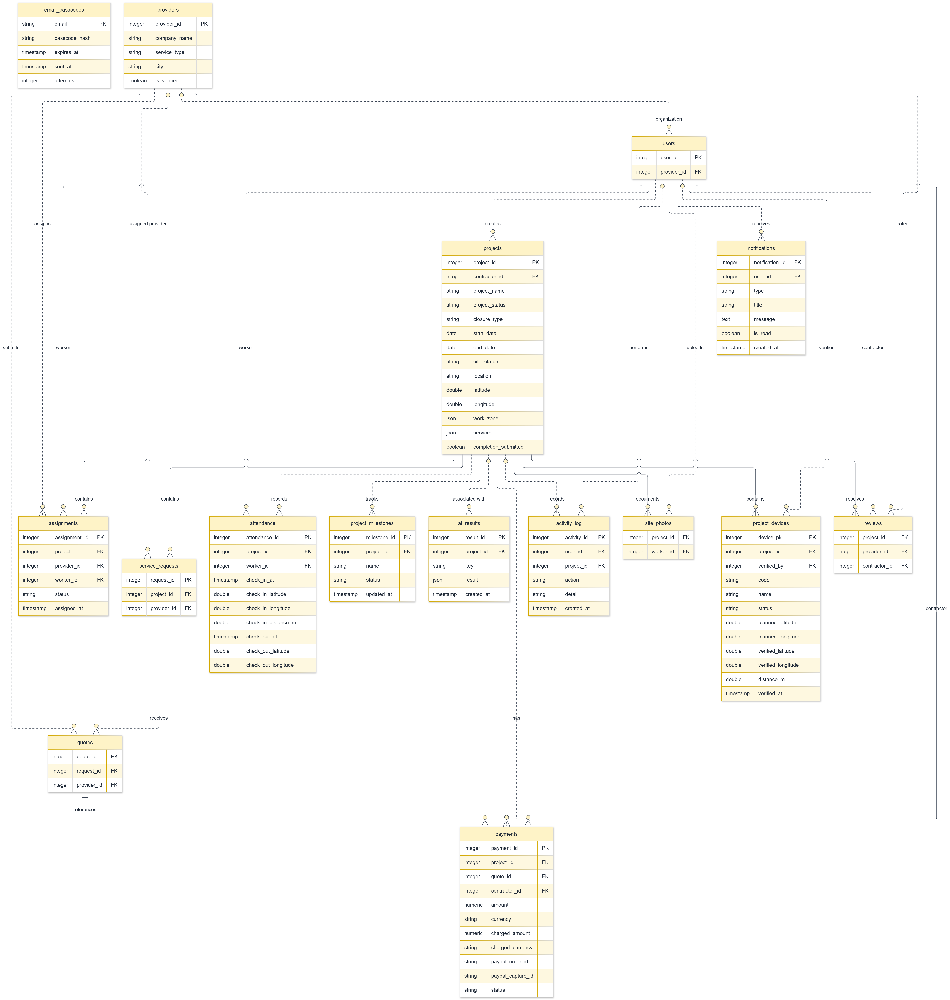

# MAMAR — Technical Architecture Showcase

| Item | Details |
|---|---|
| Project | MAMAR |
| Stage | Stage 5 — Project Closure |
| Issue | #88 |
| Prepared by | Shouq Alqarni — Backend Developer |
| Technical Review | Razan Kashr — Project Manager & GIS Integration Lead |
| Date | 24 November 2026 |
| Scope | Final MVP implementation |

## Overview

MAMAR is a GIS-enabled B2B platform designed to connect contractors with temporary traffic control service providers and support the planning, coordination, execution, and monitoring of roadwork projects.

The platform combines web application development, relational database management, geographic information systems, location-based verification, and external service integrations within a unified operational workflow.

This document presents the final MVP architecture, technology stack, API structure, database design, GIS integration, technical decisions, quality assurance results, and changes from the initial Stage 3 design.

## MAMAR at a Glance

| Technical Indicator | Final MVP |
|---|---:|
| REST API Endpoints | 86 |
| API Routers | 17 |
| Database Tables | 16 |
| Foreign Key Constraints | 26 |
| External Integrations and Browser APIs | 9 |
| Backend Unit Tests | 15 |
| Backend Integration Tests | 240 |
| Total Backend Tests | 255 |
| Backend Statement Coverage | 93% |
| Frontend Tests | 806 |
| Total Automated Tests Passed | 1,061 |

Database table counts, foreign key constraints, and spatial data fields were verified against the deployed PostgreSQL database.

API and testing metrics are based on the project's documented technical and quality assurance results.

## Table of Contents

1. [System Architecture](#1-system-architecture)
2. [GIS Architecture and Spatial Data Flow](#2-gis-architecture-and-spatial-data-flow)
3. [External Integrations](#3-external-integrations)
4. [Internal API](#4-internal-api)
5. [Database Architecture](#5-database-architecture)
6. [Security and Access Control](#6-security-and-access-control)
7. [Major Technical Decisions](#7-major-technical-decisions)
8. [Changes from the Stage 3 Design](#8-changes-from-the-stage-3-design)
9. [Testing and Quality Assurance](#9-testing-and-quality-assurance)
10. [Deployment and Monitoring](#10-deployment-and-monitoring)
11. [Technical Limitations and Future Improvements](#11-technical-limitations-and-future-improvements)
12. [Content for the Slide Deck](#12-content-for-the-slide-deck)
13. [Technical Conclusion](#13-technical-conclusion)

---

## 1. System Architecture

MAMAR follows a client-server architecture that separates the presentation layer, application logic, database management, and geographic services.

The architecture supports four primary user roles:

- Contractor
- Service Provider
- Field Worker
- Platform Administrator

### 1.1 Technology Stack

| Component | Technology | Environment | Responsibility |
|---|---|---|---|
| Frontend | React 19, Vite, React Router | Vercel / User Browser | User interfaces, dashboards, forms, maps, and workflow interactions |
| Backend | FastAPI, Pydantic, SQLAlchemy 2, Uvicorn | Render | REST APIs, business logic, validation, authentication, and authorization |
| Database | PostgreSQL | Supabase | Relational data, project records, spatial data, field evidence, and operational history |
| GIS | ArcGIS Maps SDK for JavaScript | User Browser | Interactive mapping, geographic visualization, and work-zone interaction |
| Geographic Services | ArcGIS Online | ArcGIS Online | Web maps, geographic layers, and traffic control device features |
| Location Services | Browser Geolocation API | User Device | Field worker positioning and location-based verification |
| Automated Testing | Vitest, pytest | Development and CI Environments | Frontend and backend quality assurance |
| Continuous Integration | GitHub Actions | GitHub | Automated backend unit and integration testing |
| Monitoring | UptimeRobot | External Monitoring Service | Backend availability monitoring |
| Version Control | Git and GitHub | GitHub | Source code management and collaborative development |

### 1.2 Application Request Flow

1. The user interacts with the React frontend through a web browser.
2. The frontend communicates with the FastAPI backend through HTTPS requests.
3. Protected requests include a JWT in the Authorization header.
4. The backend validates authentication, user roles, project permissions, and request data.
5. Business logic is executed through the appropriate API router.
6. PostgreSQL is accessed through SQLAlchemy when database operations are required.
7. External services are accessed when required by the requested functionality.
8. The backend returns a response to the frontend.
9. The frontend updates the interface based on the response.

Public authentication endpoints and the health endpoint do not require an existing JWT.

Interactive maps are rendered in the browser using the ArcGIS Maps SDK for JavaScript.

---

## 2. GIS Architecture and Spatial Data Flow

Geographic Information Systems are a core component of MAMAR and support the platform's project planning, field execution, and operational monitoring capabilities.

The GIS architecture combines ArcGIS Online, the ArcGIS Maps SDK for JavaScript, PostgreSQL, and browser-based geolocation.

### 2.1 GIS Components

| Component | Responsibility |
|---|---|
| ArcGIS Maps SDK for JavaScript | Interactive map rendering, geographic visualization, and work-zone interaction |
| ArcGIS Online | Geographic layers, web maps, and planned traffic control device features |
| PostgreSQL | Persistence of project geometry, geographic coordinates, verification records, and attendance data |
| FastAPI | Geographic data processing, location-based business rules, and server-side distance validation |
| Browser Geolocation API | Acquisition of field worker coordinates during location-based operations |

### 2.2 Work-Zone Management

Contractors can define geographic work zones as part of the project creation workflow.

The platform supports:

- Interactive geographic visualization.
- Identification of project locations.
- Definition of work-zone geometry.
- Storage of project coordinates.
- Persistence of work-zone geometry in PostgreSQL.
- Geographic visualization during subsequent project workflows.

Work-zone geometry is supported through the `projects.work_zone` field, which uses the PostgreSQL JSON data type.

Project latitude and longitude are stored using double-precision numeric fields.

### 2.3 Spatial Data Persistence

MAMAR uses a combined geographic and relational data architecture.

ArcGIS Online provides geographic visualization and feature services, while PostgreSQL stores spatial and operational information required by the application.

| Spatial Data | Storage Location |
|---|---|
| Project Location | PostgreSQL — `projects.location` |
| Project Latitude | PostgreSQL — `projects.latitude` |
| Project Longitude | PostgreSQL — `projects.longitude` |
| Work-Zone Geometry | PostgreSQL — `projects.work_zone` |
| Geographic Map Layers | ArcGIS Online |
| Planned Traffic Control Device Features | ArcGIS Online |
| Planned Device Coordinates | PostgreSQL — `project_devices.planned_latitude` and `planned_longitude` |
| Verified Device Coordinates | PostgreSQL — `project_devices.verified_latitude` and `verified_longitude` |
| Device Verification Distance | PostgreSQL — `project_devices.distance_m` |
| Field Worker Check-In Coordinates | PostgreSQL — `attendance.check_in_latitude` and `check_in_longitude` |
| Field Worker Check-Out Coordinates | PostgreSQL — `attendance.check_out_latitude` and `check_out_longitude` |
| Check-In Distance | PostgreSQL — `attendance.check_in_distance_m` |

The presence of these fields was verified against the deployed database schema.

Spatial data is represented through JSON geometry and geographic coordinate fields rather than being described as exclusively stored in ArcGIS Online.

### 2.4 Location-Based Field Verification

The platform implements location-based validation to support field operations.

| Verification Type | Configured Distance Threshold |
|---|---:|
| Field Worker Site Check-In | 300 meters |
| Traffic Control Device Verification | 50 meters |

The browser provides the user's geographic coordinates, while the backend performs distance validation using the relevant reference location.

Device verification records support the storage of:

- Device identifier.
- Project identifier.
- Planned geographic coordinates.
- Actual verification coordinates.
- Verification timestamp.
- Verification status.
- Verifying user.
- Calculated distance in meters.

Field attendance records support the storage of check-in and check-out timestamps, geographic coordinates, and check-in distance.

### 2.5 GIS Integration Limitations

The accuracy of location-based verification depends on:

- Availability of geographic reference data.
- Device GPS accuracy.
- Browser location permissions.
- Network connectivity.
- Availability of external geographic services.

The current MVP includes fallback behavior when planned geographic reference information is unavailable.

Project-level coordinates must not be treated as equivalent to an individual device's planned coordinates without appropriate validation.

Future improvements should prioritize verified device-level reference coordinates and explicitly identify cases where precise device verification cannot be completed.

Server-side distance validation improves consistency but does not independently guarantee that device-reported coordinates cannot be manipulated.

---

## 3. External Integrations

MAMAR integrates external services and browser APIs to extend the platform's operational capabilities.

| Integration | Accessed From | Purpose | Failure Handling or Limitation |
|---|---|---|---|
| ArcGIS Online | Frontend and Backend | Geographic visualization and planned device information | Geographic functionality may be limited when feature services are unavailable |
| Browser Geolocation API | Browser | Field worker positioning and geographic verification | Location-based actions require location permission and available coordinates |
| TomTom Traffic | Backend | Traffic conditions, speed, and delay information | Traffic information may be unavailable while other platform features remain accessible |
| Open-Meteo | Browser and selected backend workflows | Weather information and weather-related operational context | Weather-dependent information may be unavailable |
| Twilio WhatsApp | Backend | WhatsApp notification delivery | In-app notifications provide an alternative communication channel |
| EmailJS | Backend | Registration email passcodes | New account registration depends on successful passcode delivery |
| PayPal Sandbox | Backend | Demonstration of the payment workflow | Payment-related actions remain incomplete when the service is unavailable |
| Cloudflare Turnstile | Frontend and Backend | Automated bot protection during authentication | Protected authentication actions depend on successful verification |
| Anthropic Claude | Backend | AI-assisted platform features | AI-assisted functionality may be unavailable without necessarily preventing core project operations |

Browser Geolocation is a browser-provided API rather than an independently hosted external service.

### 3.1 Integration Reliability

External integrations are designed to limit the impact of individual service failures where possible.

However, some platform actions depend on their associated services.

Examples include:

- Account registration and email verification.
- Bot verification during authentication.
- Location-based field operations.
- Sandbox payment processing.

The availability of these services may affect the completion of specific workflow actions.

### 3.2 Integration Credentials

Sensitive server-side credentials and API secrets are managed through environment variables.

Examples include:

- `TOMTOM_API_KEY`
- `PAYPAL_CLIENT_SECRET`
- `ANTHROPIC_API_KEY`

Public client-side configuration values are managed separately from confidential backend credentials.

Public identifiers and browser-facing site keys must not be confused with private API secrets.

### 3.3 Payment Scope

PayPal integration operates in a sandbox environment for demonstration and testing purposes.

The current MVP does not support live financial transactions.

Production payment processing would require additional configuration, security assessment, compliance validation, and operational readiness testing.

---

## 4. Internal API

The documented backend implementation contains 86 REST API endpoints organized into 17 API routers.

Interactive API documentation:

https://mamar-api.onrender.com/docs

### 4.1 API Router Structure

| Router | Endpoints | Main Responsibility |
|---|---:|---|
| `provider` | 10 | Provider dashboard, incoming requests, projects, workers, milestones, and completion |
| `auth` | 8 | Registration, email verification, login, profiles, and account management |
| `workflow` | 8 | Quotations, provider confirmation, monitoring, completion review, and change requests |
| `admin` | 8 | Administrative dashboards, users, companies, projects, activity logs, and system status |
| `notifications` | 6 | Notification management and communication preferences |
| `field_work` | 6 | Field worker projects, site updates, site status, and photo documentation |
| `ai` | 6 | AI-assisted features and availability |
| `devices` | 5 | Traffic control device management and geographic verification |
| `attendance` | 5 | Site codes, check-in, check-out, and attendance records |
| `projects` | 4 | Project creation, retrieval, updates, and work-zone management |
| `service_requests` | 4 | Service requests, provider access, awarding, and work-zone retrieval |
| `reviews` | 4 | Provider ratings and project feedback |
| `payments` | 4 | Sandbox payment creation, retrieval, capture, and cancellation |
| `extras` | 3 | Weather location, traffic information, and PDF receipts |
| `quotes` | 2 | Quotation submission and retrieval |
| `assignments` | 2 | Field worker assignments |
| `health` | 1 | Application and database health monitoring |
| **Total** | **86** | **17 API Routers** |

The documented endpoint count treats the GET and HEAD operations associated with `/health` as one logical endpoint.

### 4.2 API Communication

The API primarily exchanges structured JSON requests and responses.

Exceptions include:

- Multipart form requests for file uploads.
- PDF responses for generated receipts.
- Responses without a body where applicable.

Protected API requests use:

`Authorization: Bearer <JWT>`

Public authentication operations, including registration, login, and email passcode operations, do not require an existing authenticated session.

### 4.3 API Error Handling

The application uses HTTP status codes to communicate request outcomes.

| Status Code | Meaning |
|---|---|
| 401 | Authentication is missing or invalid |
| 403 | The user is not authorized to perform the action |
| 404 | The requested resource was not found |
| 409 | A conflicting or duplicate operation was identified |
| 422 | Request validation failed |

Error response structures may vary according to the validation or exception-handling mechanism.

### 4.4 Role-Based and Project-Level Authorization

Access control is based on user roles and relevant project relationships.

Contractors manage their own projects and associated workflows.

Service providers can access eligible service requests and submit quotations. Access to awarded project operations depends on the applicable project and workflow permissions.

Field workers access projects according to their assignments and authorized responsibilities.

Platform administrators access administrative functions according to their assigned permissions.

### 4.5 Main Operational Workflow

The main workflow includes:

1. Contractor creates a project.
2. Contractor defines the geographic work zone.
3. Contractor submits a service request.
4. Eligible service providers review the request.
5. Service providers submit quotations.
6. Contractor reviews and selects a quotation.
7. Sandbox payment is processed where applicable.
8. Service provider assigns field workers.
9. Field workers perform authorized site operations.
10. Location-based attendance and device verification are recorded.
11. Field documentation and project updates are submitted.
12. Service provider submits the project for completion review.
13. Contractor reviews the submitted work.
14. Contractor confirms completion or requests changes.

---

## 5. Database Architecture

MAMAR uses PostgreSQL hosted on Supabase as its primary relational database.

The deployed public schema contains 16 tables and 26 foreign key constraints.

The database supports user management, project operations, quotations, payments, assignments, geographic data, field verification, notifications, and operational history.

### 5.1 Database Table Groups

| Group | Tables | Responsibility |
|---|---|---|
| Accounts | `users`, `providers`, `email_passcodes` | User accounts, service provider organizations, and registration verification |
| Core Workflow | `projects`, `service_requests`, `quotes`, `payments`, `assignments`, `project_milestones` | Project lifecycle, requests, quotations, payments, assignments, and milestones |
| Field Operations | `site_photos`, `attendance`, `project_devices` | Field documentation, attendance, and geographic device verification |
| Feedback and History | `reviews`, `notifications`, `activity_log` | Project feedback, notifications, and operational activity history |
| AI Cache | `ai_results` | Cached AI-assisted results |
| **Total** | **16 Tables** | |

### 5.2 Database Table Responsibilities

| Table | Primary Responsibility |
|---|---|
| `users` | User accounts, roles, and organizational associations |
| `providers` | Service provider company information |
| `email_passcodes` | Registration verification information |
| `projects` | Project details, status, geographic coordinates, and work-zone geometry |
| `service_requests` | Requests for temporary traffic control services |
| `quotes` | Service provider quotations |
| `payments` | Sandbox payment records and transaction references |
| `assignments` | Field worker assignments to projects |
| `project_milestones` | Project execution milestones |
| `site_photos` | Photographic field documentation |
| `attendance` | Field worker check-in and check-out records |
| `project_devices` | Traffic control device records and geographic verification |
| `reviews` | Contractor feedback and provider ratings |
| `notifications` | User notifications and read status |
| `activity_log` | Operational activity records |
| `ai_results` | Cached AI-generated results |

### 5.3 Verified Foreign Key Constraints

The following relationships were verified directly against the deployed PostgreSQL database.

| Source Table | Foreign Key | Referenced Table | Referenced Column | Delete Rule |
|---|---|---|---|---|
| `activity_log` | `project_id` | `projects` | `project_id` | SET NULL |
| `activity_log` | `user_id` | `users` | `user_id` | SET NULL |
| `ai_results` | `project_id` | `projects` | `project_id` | NO ACTION |
| `assignments` | `project_id` | `projects` | `project_id` | NO ACTION |
| `assignments` | `provider_id` | `providers` | `provider_id` | NO ACTION |
| `assignments` | `worker_id` | `users` | `user_id` | NO ACTION |
| `attendance` | `project_id` | `projects` | `project_id` | NO ACTION |
| `attendance` | `worker_id` | `users` | `user_id` | NO ACTION |
| `notifications` | `user_id` | `users` | `user_id` | CASCADE |
| `payments` | `contractor_id` | `users` | `user_id` | NO ACTION |
| `payments` | `project_id` | `projects` | `project_id` | NO ACTION |
| `payments` | `quote_id` | `quotes` | `quote_id` | NO ACTION |
| `project_devices` | `project_id` | `projects` | `project_id` | NO ACTION |
| `project_devices` | `verified_by` | `users` | `user_id` | NO ACTION |
| `project_milestones` | `project_id` | `projects` | `project_id` | CASCADE |
| `projects` | `contractor_id` | `users` | `user_id` | NO ACTION |
| `quotes` | `provider_id` | `providers` | `provider_id` | NO ACTION |
| `quotes` | `request_id` | `service_requests` | `request_id` | NO ACTION |
| `reviews` | `contractor_id` | `users` | `user_id` | NO ACTION |
| `reviews` | `project_id` | `projects` | `project_id` | NO ACTION |
| `reviews` | `provider_id` | `providers` | `provider_id` | NO ACTION |
| `service_requests` | `project_id` | `projects` | `project_id` | NO ACTION |
| `service_requests` | `provider_id` | `providers` | `provider_id` | NO ACTION |
| `site_photos` | `project_id` | `projects` | `project_id` | NO ACTION |
| `site_photos` | `worker_id` | `users` | `user_id` | NO ACTION |
| `users` | `provider_id` | `providers` | `provider_id` | NO ACTION |

All 26 verified foreign key constraints use `NO ACTION` as their update rule.

### 5.4 Referential Integrity

| Delete Rule | Number of Constraints | Purpose |
|---|---:|---|
| NO ACTION | 22 | Prevent operations that would violate existing foreign key constraints |
| CASCADE | 2 | Automatically remove dependent notifications or project milestones when the referenced record is deleted |
| SET NULL | 2 | Preserve activity history while removing references to deleted users or projects |
| **Total** | **26** | |

The database uses foreign key constraints to maintain consistency between related operational records.

### 5.5 Geographic Database Fields

The following geographic fields were verified against the deployed database schema.

| Table | Column | Data Type |
|---|---|---|
| `projects` | `location` | Character Varying |
| `projects` | `latitude` | Double Precision |
| `projects` | `longitude` | Double Precision |
| `projects` | `work_zone` | JSON |
| `project_devices` | `planned_latitude` | Double Precision |
| `project_devices` | `planned_longitude` | Double Precision |
| `project_devices` | `verified_latitude` | Double Precision |
| `project_devices` | `verified_longitude` | Double Precision |
| `project_devices` | `distance_m` | Double Precision |
| `attendance` | `check_in_latitude` | Double Precision |
| `attendance` | `check_in_longitude` | Double Precision |
| `attendance` | `check_in_distance_m` | Double Precision |
| `attendance` | `check_out_latitude` | Double Precision |
| `attendance` | `check_out_longitude` | Double Precision |

This database structure supports the persistence of geographic project information, planned and verified device locations, and location-based attendance records.

### 5.6 Database Schema Management

SQLAlchemy is used to define database models and manage application-level database interactions.

The current implementation includes startup-based schema initialization and conditional column additions using statements such as:

`ALTER TABLE ... ADD COLUMN IF NOT EXISTS`

Conditional schema statements support repeatable execution but do not eliminate database locking or migration risks.

A dedicated migration framework, such as Alembic, is recommended for future releases.

---

## 6. Security and Access Control

MAMAR implements application-level security mechanisms to protect authentication and authorized workflow operations.

### 6.1 Implemented Security Mechanisms

| Security Mechanism | Implementation |
|---|---|
| Authentication | JWT-based authentication |
| Token Expiration | 60 minutes |
| Password Protection | Argon2 password hashing |
| Authorization | Role-based access control |
| Resource Access | Project-level permission validation |
| Login Protection | Lockout after 10 failed attempts within 15 minutes |
| Bot Protection | Cloudflare Turnstile |
| Registration Verification | Email passcodes |
| Site Verification Code | HMAC-based project site code |
| Input Validation | Pydantic request validation |
| Communication | HTTPS |
| Credential Management | Environment-based configuration for sensitive backend credentials |

### 6.2 Database Access Security

The backend is responsible for applying application-level authorization before performing protected database operations.

Application-level authorization and database-level access controls are separate security mechanisms.

Database permissions, direct API exposure, and Row Level Security policies require additional validation before the platform can be considered production-ready.

The presence of backend authentication must not be interpreted as confirmation that every database access path is independently protected.

### 6.3 Geographic Verification Security

Location-based validation is performed through server-side distance calculations using device-reported geographic coordinates.

This approach reduces reliance on client-generated verification flags.

However, additional controls would be required to provide stronger protection against location spoofing and manipulated device coordinates.

---

## 7. Major Technical Decisions

The following decisions reflect the technical requirements, project constraints, and implementation trade-offs encountered during MVP development.

| Technical Decision | Rationale | Alternative | Trade-Off |
|---|---|---|---|
| FastAPI with Pydantic | Structured APIs, request validation, and automatically generated API documentation | Flask with manually maintained documentation | Additional schema definitions and maintenance |
| React and Vite | Component-based frontend development and efficient development workflows | Traditional server-rendered interfaces | Increased client-side state management |
| Vercel, Render, and Supabase | Managed deployment services suitable for a student development team | Self-managed virtual infrastructure | Multiple hosting environments require coordinated configuration |
| PostgreSQL | Relational consistency across projects, users, quotations, and operational records | Non-relational database architecture | Schema changes require careful migration management |
| ArcGIS Integration | Geographic visualization and location-based project operations | Non-geographic project management | Dependence on geographic services and spatial data quality |
| JSON-Based Work-Zone Storage | Flexible persistence of project geometry within the existing relational database | Dedicated spatial database extensions | Advanced spatial queries may require additional processing |
| Centralized Access Control | Consistent authorization across shared project workflows | Independent authorization logic in each router | Shared authorization components require comprehensive testing |
| Backend Distance Validation | Centralized enforcement of location-based operational rules | Client-side verification flags | Dependence on GPS accuracy and reference coordinate availability |
| HMAC-Based Site Codes | Deterministic site verification codes without additional code-storage requirements | Random codes stored in the database | Secret rotation may affect existing site codes |
| Database-Based Field Documentation | Simplified association between project records and field evidence | Dedicated object storage | Database growth and backup requirements |
| Browser-Based Weather Requests | Addressed weather service availability issues encountered in the deployment environment | Backend-only weather requests | Dependence on browser connectivity |
| Independent Integration Error Handling | Reduce unnecessary disruption from external service failures | Treat all integration failures as application-wide failures | Additional error-handling paths and testing requirements |
| Automated CI Testing | Detect integration issues before changes are merged | Manual testing only | Additional CI execution time |
| PayPal Sandbox | Demonstrate the payment workflow without processing real transactions | Live payment processing | Limited to demonstration and testing |
| AI Result Caching | Reduce repeated processing of equivalent AI-assisted requests | Reprocess every request | Cache invalidation and storage requirements |

---

## 8. Changes from the Stage 3 Design

The final MVP expanded beyond the initial technical design as additional operational requirements were implemented.

| Area | Stage 3 Plan | Final MVP | Reason for Change |
|---|---|---|---|
| REST API Endpoints | 12 | 86 | Additional operational workflows and platform features |
| API Routers | 5 | 17 | Separation of responsibilities across application modules |
| Database Tables | 6 | 16 | Additional entities required by the expanded workflow |
| Database Hosting | PostgreSQL on Render | PostgreSQL on Supabase | Separation of database hosting from backend deployment |
| GIS Integration | Frontend-focused geographic visualization | Frontend and backend GIS integration | Geographic data persistence and server-side verification |
| Payments | Not included | PayPal Sandbox | Demonstration of quotation-related payment operations |
| Messaging | Not included | In-app notifications, WhatsApp, and email verification | Improved communication and account verification |
| Field Operations | Initial field workflow | Attendance, device verification, photos, and milestones | Expanded field execution and monitoring requirements |
| AI-Assisted Features | Not included in the initial design | AI-assisted operational features | Additional decision-support functionality |
| Monitoring | Limited initial scope | Backend health monitoring | Improved deployment visibility |
| Automated Testing | Initial testing approach | Frontend and backend automated test suites | Improved regression testing and quality assurance |

---

## 9. Testing and Quality Assurance

The MAMAR MVP was evaluated through automated frontend testing, backend unit testing, backend integration testing, and manual workflow validation.

### 9.1 Documented Automated Testing Results

| Testing Category | Tests Passed |
|---|---:|
| Frontend Tests | 806 |
| Backend Unit Tests | 15 |
| Backend Integration Tests | 240 |
| Total Backend Tests | 255 |
| **Total Automated Tests** | **1,061** |

### 9.2 Code Coverage

| Component | Documented Coverage |
|---|---:|
| Backend Statement Coverage | 93% |
| Frontend Coverage | 91.37% |

The frontend coverage figure was recorded during a separate documented coverage run and should not be interpreted as a newly measured result from the final 806-test run.

### 9.3 Testing Approach

The project testing approach includes:

- Frontend component and application testing using Vitest.
- Backend unit testing using pytest.
- Backend integration testing against PostgreSQL.
- Automated backend testing through GitHub Actions.
- Manual user acceptance testing.
- Validation of cross-role operational workflows.
- Deployment verification.

### 9.4 Quality Assurance Scope

Testing activities covered key areas including:

- Authentication and authorization.
- Project creation and management.
- Service requests and quotations.
- Field worker assignments.
- Geographic verification.
- Field documentation.
- Project monitoring.
- Completion review.
- Sandbox payment integration.
- External service error handling where documented.

The recorded test results are based on the project's existing quality assurance documentation.

These results do not constitute an independent security audit or certification of production readiness.

---

## 10. Deployment and Monitoring

MAMAR uses managed cloud hosting services to support deployment and accessibility of the MVP.

### 10.1 Deployment Architecture

| Component | Hosting Platform |
|---|---|
| Frontend | Vercel |
| Backend | Render |
| Database | Supabase |
| Geographic Services | ArcGIS Online |
| Source Code | GitHub |
| Continuous Integration | GitHub Actions |
| Availability Monitoring | UptimeRobot |

### 10.2 Deployment Branch

The production deployment source is the `main` branch, as confirmed by the project management team.

Development and integration activities may use separate branches before changes are incorporated into the production branch.

### 10.3 Application Access

Frontend Application:

https://mammar-blush.vercel.app/

Backend API Documentation:

https://mamar-api.onrender.com/docs

### 10.4 System Monitoring

The backend exposes a `/health` endpoint for application availability and database connection monitoring.

The health endpoint supports GET and HEAD requests to accommodate monitoring services.

UptimeRobot is used to monitor backend availability.

Availability monitoring does not independently validate every application feature or external integration.

---

## 11. Technical Limitations and Future Improvements

The current implementation represents an MVP intended to demonstrate the feasibility and functionality of the MAMAR platform.

Additional improvements are recommended before broader operational deployment.

| Recommended Improvement | Expected Benefit | Priority |
|---|---|---|
| Introduce dedicated Alembic migrations | Reduce schema management and deployment risks | High |
| Standardize Python versions across environments | Improve consistency and reproducibility | High |
| Expand automated end-to-end testing | Detect cross-role workflow issues earlier | High |
| Review database permissions and Row Level Security policies | Strengthen database-level access protection | High |
| Improve device-level geographic reference validation | Reduce inaccurate verification caused by unavailable or unsuitable reference coordinates | High |
| Validate external integration failure scenarios | Improve workflow resilience | High |
| Introduce object storage for field documentation | Improve database scalability and backup efficiency | Medium |
| Strengthen protection against location spoofing | Improve confidence in geographic verification | Medium |
| Establish API contracts before implementation | Improve frontend and backend coordination | Medium |
| Adopt smaller and more focused pull requests | Reduce merge conflicts and simplify reviews | Medium |
| Evaluate advanced spatial database capabilities | Support more complex geographic queries and spatial analysis | Medium |
| Prepare production payment integration | Enable real financial transactions following compliance and security validation | Future Scope |

---

## 12. Content for the Slide Deck

The following content is prepared for inclusion in the final project presentation.

### Slide 1 — System Architecture

Suggested visual:

`diagrams/system-architecture.png`

Key points:

- React frontend hosted on Vercel.
- FastAPI backend hosted on Render.
- PostgreSQL database hosted on Supabase.
- ArcGIS Online and ArcGIS Maps SDK integration.
- 86 documented REST API endpoints across 17 routers.
- Role-based and project-level authorization.

### Slide 2 — GIS Integration

Key points:

- Interactive geographic project visualization.
- Geographic work-zone definition.
- Work-zone geometry stored in PostgreSQL as JSON.
- Integration with ArcGIS Online geographic services.
- Location-based field attendance.
- Geographic verification of traffic control devices.
- Persistence of planned and verified coordinates.

### Slide 3 — End-to-End Workflow

Suggested visual:

`diagrams/main-workflow.png`

Key points:

- Contractor creates a project and defines the work zone.
- Service providers submit quotations.
- Contractor selects a quotation.
- Payment workflow is demonstrated through PayPal Sandbox.
- Service provider assigns field workers.
- Field workers perform geographic verification and document site activities.
- Contractor reviews the submitted work and confirms completion or requests changes.

### Slide 4 — Database Architecture

Suggested visual:

`diagrams/database.png`

Key points:

- 16 verified PostgreSQL tables.
- 26 verified foreign key constraints.
- Five functional database groups.
- Relational and geographic data persistence.
- Support for project records, field evidence, attendance, and device verification.

### Slide 5 — Testing and Quality Assurance

Key points:

- 806 frontend tests.
- 15 backend unit tests.
- 240 backend integration tests.
- 1,061 documented automated tests passed.
- 93% backend statement coverage.
- Automated backend testing through GitHub Actions.
- Manual user acceptance testing and deployment verification.

---

## 13. Technical Conclusion

The final MAMAR MVP demonstrates the integration of web application development, backend services, relational database management, and Geographic Information Systems within a unified platform for temporary traffic control operations.

The implementation expanded beyond the initial Stage 3 design, incorporating additional API modules, database entities, geographic verification capabilities, field documentation, notifications, sandbox payment functionality, and AI-assisted features.

The deployed PostgreSQL database contains 16 tables and 26 verified foreign key constraints, supporting both relational and geographic data persistence.

The GIS architecture combines ArcGIS Online, interactive web mapping, PostgreSQL-based spatial data storage, and location-based operational validation.

Documented quality assurance results include 1,061 passed automated tests and 93% backend statement coverage.

The current MVP provides a foundation for future development, with further improvements focused on security validation, geographic verification accuracy, database migration management, integration resilience, scalability, and production readiness.
