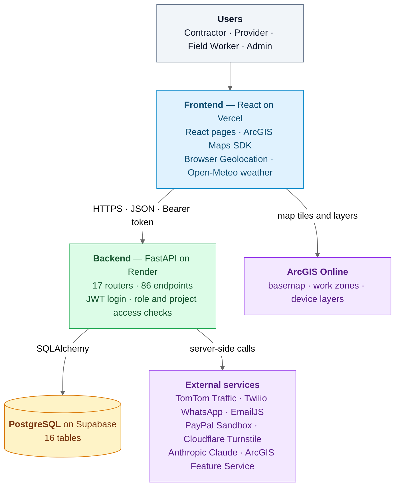
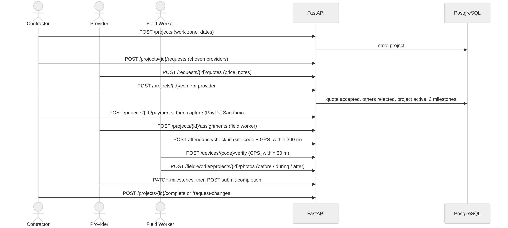

# MAMAR — Technical Architecture Showcase

| | |
|---|---|
| **Issue** | #88 |
| **Prepared by** | Shouq Alqarni, backend and database |
| **Date** | 24 November 2026 |
| **Scope** | The MVP as deployed on 24 November 2026, not the Stage 3 plan |

This page shows how MAMAR is built. It covers the system parts, the external services, the API, the database and the main technical decisions. Every diagram is also saved as an image in [`diagrams/`](diagrams/) for the slide deck.

## MAMAR at a glance

| Measure | Value |
|---|---:|
| REST endpoints | 86 |
| API routers | 17 |
| Database tables | 16 |
| External services | 9 |
| Backend tests (unit + integration) | 255 (15 + 240) |
| Backend statement coverage | 93% |
| Frontend tests (Vitest) | 806 |

## Contents

1. [System architecture](#1-system-architecture)
2. [External services](#2-external-services)
3. [Internal API](#3-internal-api)
4. [Database](#4-database)
5. [Major technical decisions](#5-major-technical-decisions)
6. [Changes from the Stage 3 design](#6-changes-from-the-stage-3-design)
7. [Content for the slide deck](#7-content-for-the-slide-deck)

---

## 1. System Architecture

### How a request moves

1. The user works in the React app.
2. The app sends a JSON request to the FastAPI backend. The request carries a JWT in the `Authorization` header.
3. The backend checks the token, the user's role and the user's access to the project.
4. The backend reads or writes PostgreSQL through SQLAlchemy. It calls an external service only when the request needs one.
5. The backend returns JSON, and the app updates the page.

Maps are drawn in the browser by the ArcGIS Maps SDK. The worker's position comes from the browser's Geolocation API.

### Components

| Component | Technology | Hosting | Responsibility |
|---|---|---|---|
| Frontend | React 19, Vite, React Router | Vercel | Pages for the four roles, maps, forms and dashboards |
| Backend | FastAPI, Pydantic, SQLAlchemy 2, Uvicorn | Render | REST API, validation, business rules and access control |
| Database | PostgreSQL | Supabase | All non-spatial data, including site photos |
| GIS | ArcGIS Maps SDK for JavaScript, ArcGIS Online | ArcGIS Online | Web map, work zones and planned traffic device points |
| Location | Browser Geolocation API | User's phone | Position for site check-in and device verification |
| Monitoring | UptimeRobot on `/health` | UptimeRobot | Alerts when the backend or its database connection is down |
| CI | GitHub Actions with pytest | GitHub | Runs the backend unit and integration tests on every pull request |

Vercel and Render both deploy automatically from the `develop` branch.

---

## 2. External Services

| Service | Called from | What MAMAR uses it for | If it is not available |
|---|---|---|---|
| ArcGIS Online (Feature Service) | Browser (SDK) and backend | The web map; the backend reads the planned point of a traffic device | The backend uses the project's saved location instead |
| Browser Geolocation | Browser | Worker position for check-in (300 m) and device verification (50 m) | The worker cannot verify until location access is allowed |
| TomTom Traffic Flow | Backend | Live speed and delay near the work zone, with a traffic level | The traffic card says the service is off |
| Open-Meteo | Browser (weather card) and backend (daily summary) | Today's weather and safety advice for the site | The weather card shows an error; the page still works |
| Twilio WhatsApp | Backend | WhatsApp copies of important notifications | In-app notifications still work |
| EmailJS | Backend | Passcode email during registration | New accounts cannot be created until it is back |
| PayPal Sandbox | Backend | Test payment for an accepted quotation | The quotation stays unpaid; no real money is involved |
| Cloudflare Turnstile | Browser and backend | Bot check on login and registration | Login and registration are refused |
| Anthropic Claude (Haiku) | Backend | Photo safety check, traffic plan explanation, quotation comparison, daily summary | The smart features are hidden; the main workflow does not use them |

Only EmailJS and Turnstile block a user action when they fail, and both block on purpose: they protect account creation and login. A failure in any other service affects only its own card.

All keys are environment variables on Render, for example `TOMTOM_API_KEY`, `PAYPAL_CLIENT_SECRET` and `ANTHROPIC_API_KEY`. No key is stored in the code or sent to the browser.

---

## 3. Internal API

The backend has **86 endpoints in 17 routers**. The count comes from the OpenAPI specification, where `GET` and `HEAD /health` count as one endpoint. The live list, with request and response examples, is at **https://mamar-api.onrender.com/docs**.

| Router | Endpoints | Main use |
|---|---:|---|
| `provider` | 10 | Provider dashboard, incoming requests, projects, workers, milestones and completion |
| `auth` | 8 | Email passcode, registration, login, profile, password change and avatar |
| `workflow` | 8 | Quotation list and rejection, provider confirmation, monitoring, completion review and change requests |
| `admin` | 8 | Admin summary, users, companies, projects, activity log and system status |
| `notifications` | 6 | Notification list, unread count, read state and the WhatsApp channel |
| `field_work` | 6 | Field worker projects, site status, site updates and photos |
| `ai` | 6 | Smart features and their status |
| `devices` | 5 | Device codes for providers and workers, and GPS verification |
| `attendance` | 5 | Site code, check-in, check-out and attendance log |
| `projects` | 4 | Create, list, read and update projects with their work zone |
| `service_requests` | 4 | Send requests to providers, list them, award them and read the work zone |
| `reviews` | 4 | Provider ratings |
| `payments` | 4 | Create a PayPal order, list payments, capture and cancel |
| `extras` | 3 | Weather location, live traffic and the PDF receipt |
| `quotes` | 2 | Submit and list quotations for a request |
| `assignments` | 2 | Assign field workers |
| `health` | 1 | Service and database status |

### Rules for every endpoint

- Requests and responses are JSON. Photo upload (`multipart/form-data`) and the PDF receipt are the only exceptions.
- Every endpoint needs `Authorization: Bearer <JWT>`, except registration, login and health. The token holds the user id and role, and it expires after 60 minutes.
- Errors always return `{"detail": "..."}` with a clear status: 401 for a missing or bad token, 403 for the wrong role or project, 404 for not found, 409 for a duplicate and 422 for invalid data.
- Access is checked per project, not only per role. A provider sees a project only after their quotation is accepted. A worker sees it only after being assigned to it.

### Main workflow through the API

---

## 4. Database

PostgreSQL holds **16 tables in five groups**. Spatial shapes, such as work-zone polygons and device points, stay in ArcGIS Online. PostgreSQL keeps only the coordinates the backend needs for its distance checks.

| Group | Tables | Notes |
|---|---|---|
| Accounts | `users`, `providers`, `email_passcodes` | Four roles in `users.role`; passwords hashed with Argon2; `email_passcodes` holds the hashed sign-up code before the account exists |
| Core workflow | `projects`, `service_requests`, `quotes`, `payments`, `assignments`, `project_milestones` | The path from project to completion; payments and milestones were added after Stage 3 |
| Field evidence | `site_photos`, `attendance`, `project_devices` | Photos (JPEG, PNG or WebP, up to 5 MB, 10 per upload), check-in times and the last GPS verification of each device |
| Feedback and history | `reviews`, `notifications`, `activity_log` | Ratings after completion, notifications and a record of who did what |
| Cache | `ai_results` | Saved smart-feature answers, so the same photo or plan is not analysed twice |

SQLAlchemy creates the tables at start-up. Columns added after the first deploy use `ALTER TABLE ... ADD COLUMN IF NOT EXISTS`, so the live database is upgraded without losing data.

---

## 5. Major Technical Decisions

Each decision below came from a real constraint of this project. The table lists the option we did not choose and the cost of our choice.

| Decision | Project constraint behind it | Alternative not chosen | Trade-off we accepted |
|---|---|---|---|
| FastAPI with Pydantic | The frontend team needed an exact, current API contract while the backend kept changing | Flask with hand-written documentation | More schema classes to write and maintain |
| Vercel (frontend), Render (backend), Supabase (database) | A student team with no server administrator; every merged pull request had to go live with no manual steps | One self-managed virtual server | Three dashboards to keep in sync; CORS allows only the production frontend address |
| One relational database for all non-spatial data | Quotations, payments, assignments and photos all hang off one project, so the queries need joins | Separate file storage for photos | Photos make the database grow faster than file storage would |
| Access checks in one shared module (`core/access.py`) | Four roles share the same projects, and one missed check would expose another company's data | Checks written separately in each router | Every router depends on one module; 7 security tests guard it |
| Backend reads ArcGIS for device verification | The planned device position must come from the server, or a worker could fake it in the browser | Browser-only ArcGIS, as planned in Stage 3 | One more external call on the server |
| Distance checks on the server (300 m check-in, 50 m device) | Proof of presence on site is the purpose of check-in | Trusting a "verified" flag sent by the browser | Poor GPS on some phones, so the limits are generous |
| Site code is an HMAC of the project id | Workers scan a printed QR code on site, so the code must be hard to guess | A random code stored in a table | Changing `SECRET_KEY` changes every site code |
| Each external service fails on its own | Nine outside services, and a test or demo cannot stop because one of them is down | Hard failures that stop the request | More code paths to test |
| Weather loaded in the browser | Open-Meteo refused requests from Render's shared servers | A paid weather API called from the backend | The user's browser must reach Open-Meteo |
| Tests on every pull request (GitHub Actions with a PostgreSQL service) | Several team members merged into `develop`, and every merge deploys to production automatically | Running tests by hand before a merge | About 3 minutes of waiting per pull request |

---

## 6. Changes from the Stage 3 Design

| Area | Stage 3 plan | Final MVP | Reason for the change |
|---|---|---|---|
| API size | 12 endpoints in 5 routers | 86 endpoints in 17 routers | Field work, devices, payments, notifications, admin and smart features were added |
| Database size | 6 tables | 16 tables | New tables for the added features |
| Database host | PostgreSQL on Render | PostgreSQL on Supabase | The database is managed separately from the backend host |
| ArcGIS | No link between FastAPI and ArcGIS Online | Backend reads planned device points | Device verification must not trust the browser |
| Payments | None | PayPal Sandbox (test only) | Payment of an accepted quotation completes the workflow |
| Messaging | None | In-app notifications, WhatsApp (Twilio) and email passcode (EmailJS) | Users must learn about new requests, quotations and changes |

---

## 7. Content for the Slide Deck

**Slide 1 — System architecture** (image: `diagrams/system-architecture.png`)
- React on Vercel, FastAPI on Render and PostgreSQL on Supabase, with maps from ArcGIS Online.
- 86 REST endpoints protected by JWT, with access checked per project.
- Nine external services; a failure in one does not stop the main workflow.

**Slide 2 — From request to completion** (image: `diagrams/main-workflow.png`)
- The contractor creates the project, the providers send quotations, and the contractor confirms one and pays in the sandbox.
- The field worker checks in with the site QR code and GPS, verifies devices within 50 m and uploads photos.
- The provider completes the milestones, and the contractor reviews the work.

**Slide 3 — Data** (image: `diagrams/database.png`)
- 16 tables in five groups: accounts, core workflow, field evidence, feedback and history, and cache.
- Spatial data stays in ArcGIS Online; everything else is in PostgreSQL.

**Slide 4 — Quality**
- 255 backend tests (15 unit and 240 integration) with 93% statement coverage.
- 806 frontend tests in Vitest.
- Backend tests run automatically on every pull request.
